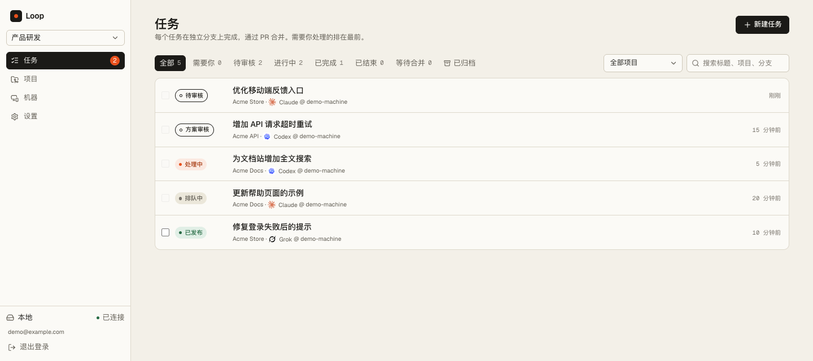

<div align="center">

# Loop

**把用户反馈变成经过审核、可以发布的代码。**

Trigger → Agent → Build → Review → Ship

[](https://github.com/i1mT/loop/actions/workflows/ci.yml)
[](LICENSE)
[](https://nodejs.org/)
[](https://agentclientprotocol.com/)

[快速开始](#快速开始) · [功能](#功能) · [自托管](docs/self-hosting.md) · [参与贡献](.github/CONTRIBUTING.md) · [English](docs/i18n/README.en.md)

</div>

---

Loop 是一个自托管的 AI 开发工作台：从网页、API、反馈 SDK 或飞书接收需求，把任务交给开发者机器上的 coding agent，在独立 Git worktree 中修改代码、运行项目检查、创建 PR，再由人审核并发布。

它连接你已有的仓库、机器和智能体。代码执行在你的机器上，网关负责同步任务与审核记录。

> **项目状态：早期版本，持续迭代。** 当前提供 Web 工作台与 Node.js 守护进程，适合个人开发者和小型团队。建议先在测试仓库完成完整流程，再接入重要项目。



<p align="center"><sub>工作台示例，全部使用合成项目与演示账号。</sub></p>

## 为什么使用 Loop

- **缩短反馈到 PR 的距离**：保留反馈背景、附件和来源，直接进入开发流程。
- **沿用已有开发环境**：使用本机 Git、GitHub CLI、智能体登录和工具链。
- **把审核对象说清楚**：批准的是具体提交，主分支同步使用 merge，产生新提交后重新审核；真实冲突交回原会话处理。
- **保留任务上下文**：需求、会话、技术方案、改动、检查、PR 和发布结果关联到同一个任务。

## 工作流程


## 功能

| 能力 | 当前支持 |
| --- | --- |
| 任务与反馈 | Markdown 需求、图片附件、优先级、归档与恢复 |
| 多空间协作 | 账号与项目隔离，机器可以接入多个空间 |
| 本地执行 | 连接码安装、独享与共享机器、多机器分配、独立 worktree、租约与心跳 |
| 智能体配置 | 在机器上选择智能体、模型与思考程度 |
| 会话与审核 | 会话记录、改动、检查、活动、方案审核与代码审核 |
| 代码托管 | GitHub PR、自建 GitLab MR、核对批准提交、原会话发布与失败重试 |
| 小问题合并 | 小反馈进入项目池，达到数量或手动触发后统一处理 |
| 网站接入 | 项目 API 密钥、嵌入式反馈 SDK、截图与来源信息 |
| 飞书接入 | 空间机器人、单聊/群聊创建任务、同一话题进度回复、Wiki 方案文档 |
| 持续迭代 | 已发布任务继续沿用会话上下文，开始新一轮 PR |

### 支持的智能体

通过 [Agent Client Protocol](https://agentclientprotocol.com/) 接入，模型和授权来自各自的 CLI。

| 智能体 | 适配方式 | 运行要求 |
| --- | --- | --- |
| Claude Code | `claude-agent-acp` | 配置 Claude Code 的认证 |
| Codex | `codex-acp` | 配置 Codex 的认证 |
| Grok | `grok agent stdio` | 安装并配置 Grok CLI |
| OpenCode | `opencode acp` | 安装并配置 OpenCode |
| Pi | `pi-acp` → `pi --mode rpc` | 安装 Pi CLI |
| DeepSeek Harness | `dsh --profile acp` | 配置 Harness 及其模型供应商 |

项目内适配器由依赖安装提供；具体命令见 [智能体配置](docs/self-hosting.md#智能体与机器)。

## 快速开始

需要 **Node.js 24+、pnpm、Git、已登录的 GitHub CLI**，以及至少一个配置好的智能体。网关还需要自己的 **Neon Postgres 数据库**；线上部署使用 Cloudflare Workers 与 R2。

```bash
git clone https://github.com/i1mT/loop.git
cd loop
corepack enable
pnpm install --frozen-lockfile
cp apps/web/.dev.vars.example apps/web/.dev.vars
```

填写 `apps/web/.dev.vars` 中的开发数据库连接串和密钥。分别生成随机值，不要直接使用示例值：

```bash
node -e "console.log(require('crypto').randomBytes(32).toString('base64'))"
```

初始化数据库并创建自己的超级管理员：

```bash
node --env-file=apps/web/.dev.vars --experimental-strip-types scripts/migrate.mjs
node --env-file=apps/web/.dev.vars scripts/create-user.mjs admin@example.com --super
```

启动开发网关：

```bash
pnpm --filter @loop/web run dev --port 5190
```

另开终端，把 `LOOPD_DAEMON_TOKEN` 设置为 `.dev.vars` 中相同的值，连接守护进程：

```bash
export LOOPD_GATEWAY=http://localhost:5190
export LOOPD_DAEMON_TOKEN='your-generated-daemon-token'
./scripts/start-daemon.sh
```

打开 **http://localhost:5190**，登录刚创建的账号，创建空间、接入机器、创建项目，然后提交任务。浏览器登录使用邮箱与密码；API 令牌不能用来登录页面。

生产部署、本机转发模式、备份与故障恢复见 [自托管指南](docs/self-hosting.md)。

## 接入你的项目

在项目根目录的 `AGENTS.md` 写清楚项目规则、验证命令和发布说明：

```markdown
# Project instructions

- 测试：`npm test`
- 预览：`npm run preview`

## 发布

合并后在任务工作树中执行 npm run deploy。
所需配置从项目外的固定路径读取，不要将凭证写入仓库。
部署命令退出成功后，还需要检查应用的健康接口。
```

智能体修改的是任务工作树。守护进程负责 GitHub 分支与 PR 操作；发布时复用原会话，让智能体按照项目说明执行。未配置测试命令时不会自动添加测试检查。

## 架构

| 模块 | 职责 | 技术 |
| --- | --- | --- |
| `apps/web` | Web 工作台、HTTP API、身份、任务、飞书后台同步 | vinext、React、Cloudflare Workers、Neon、R2 |
| `apps/daemon` | 机器发现、会话、worktree、检查、PR 与发布 | Node.js、ACP、Git、GitHub CLI |
| `packages/core` | 状态机、属性和会话事件协议 | TypeScript |
| `apps/web/sdk` | 可嵌入网站的反馈入口 | TypeScript |

daemon 仅通过 HTTP 与网关通信，不直接连接数据库。源码与开发工具在本机执行；任务元数据和会话记录同步到你自己部署的网关与数据库。

详细设计见 [架构说明](docs/architecture.md)。

## 数据与执行边界

- **worktree 是 Git 隔离，不是操作系统沙箱。** 智能体以自动批准模式启动，可能访问执行账号有权限访问的文件和网络。
- 模型请求遵循你选择的智能体与供应商配置，并不保证模型推理离线运行。
- API、SDK、飞书是不同的接入边界；SDK 反馈按身份校验区分可信度。所有接入仍应只用于受信任、受管理的项目。
- 配置、认证密钥和数据库备份由部署者管理。不要提交 `.env`、`.dev.vars`、本机日志或含凭证的截图。

报告安全问题请使用 [私密安全报告入口](.github/SECURITY.md)。

## 开发与贡献

```bash
pnpm run typecheck
pnpm run test
pnpm run build
```

数据库集成测试需要独立测试数据库，见 [开发指南](docs/development.md)。欢迎提交 bug、改进文档、新增适配器和可复现的恢复测试；请先阅读 [贡献指南](.github/CONTRIBUTING.md)。

## 文档

- [自托管与配置](docs/self-hosting.md)
- [架构与任务生命周期](docs/architecture.md)
- [API、SDK 与飞书](docs/integrations.md)
- [开发与测试](docs/development.md)
- [第三方声明](docs/legal/THIRD_PARTY_NOTICES.md)

## 致谢与许可证

感谢 [ACP](https://agentclientprotocol.com/)、[vinext](https://github.com/cloudflare/vinext)、[Cloudflare](https://developers.cloudflare.com/)、[Neon](https://neon.com/)、[Radix UI](https://www.radix-ui.com/)、[Lucide](https://lucide.dev/) 和 [LobeHub Icons](https://github.com/lobehub/lobe-icons)。

Loop 采用 [MIT License](LICENSE)。第三方依赖和品牌图标保留各自授权及标识权利，详见 [第三方声明](docs/legal/THIRD_PARTY_NOTICES.md)。
