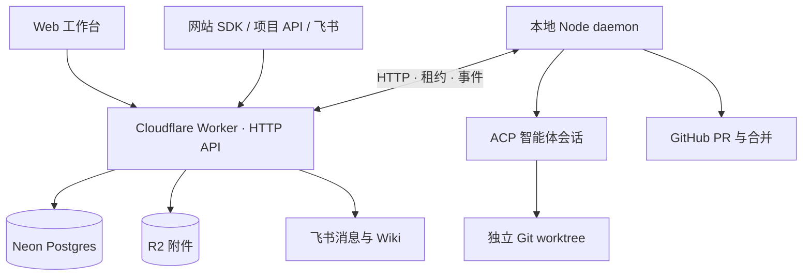

# 架构与执行模型

Loop 将协调与执行分开：网关记录事实，本地 daemon 驱动智能体与 Git。

## 目录

- `apps/web/app`：页面与 API 路由。
- `apps/web/lib`：数据访问、任务、身份、空间、集成和持久后台任务。
- `apps/web/components`：页面组件与共享 UI。
- `apps/web/sdk`：浏览器反馈 SDK；构建产生 `public/sdk.js`。
- `apps/daemon/src`：ACP 会话、机器发现、worktree、GitHub 流程与发布。
- `packages/core/src`：共享状态机、任务属性和会话事件。

## 反馈与任务

所有入口调用 `submitFeedback`，首先产生反馈。符合条件的小反馈可以进入项目池；数量达到阈值或管理员手动处理时，合成一个任务、一个会话和一个 PR。

反馈来源与任务分离，因此合并后仍能通知原聊天，也能逐条保留可信度声明。没有最长自动等待时间，凑不满时需要手动触发。

## 执行与审核

任务记录机器、智能体、模型和思考程度。daemon 领取租约，使用独立 worktree 启动会话，批量回传幂等事件。心跳独立于执行循环，避免长时间测试或推送导致租约过期。

完成一轮后，daemon 运行项目声明的检查、推送分支并创建 PR。审核记录批准的提交哈希；主分支同步使用 merge 保留已解决的冲突；产生新提交后需要重新审核。真实冲突持久交回原会话处理，完成后更新原 PR。

PR 合并后，将任务自己的工作树对齐合并后的主分支，再由原智能体会话读取项目发布说明并执行。明确成功/失败会更新结果；没有明确结论时等待人工确认。

## 技术方案与飞书

已启用空间的任务先以只分析方式输出结构化方案。网关保存版本并创建 Wiki 文档；同步成功后，根据审核设置决定等待人工批准或继续实现。

方案按 task、round、revision 保存；批准绑定具体 revision。实现和发布记录追加到同一任务文档。既有方案任务继续迭代时保留前轮历史，不把旧事件当作新轮输出。

消息、通知与文档同步使用持久数据库记录、执行租约、幂等键和远端对账。请求结束后的唤醒改善响应时间，定时扫描负责恢复中断工作。

## 身份与数据

账号由管理员创建，不开放注册。超级管理员使用数据库角色管理空间和账号；项目按空间隔离，任务和反馈继承项目归属。机器可以接入多个空间。

浏览器使用签名会话；管理 API、daemon 与项目 API 密钥承担不同职责。SDK 公钥允许嵌入前端，身份签名密钥只能保存在接入网站的服务端。飞书凭证在网关加密保存，不能交给 daemon 或智能体。

协议细节见 [daemon 协议](contracts/daemon-protocol.md)、[任务状态](contracts/task-states.md) 和 [会话事件](contracts/session-events.md)。契约文档记录部分演进背景，实现与测试是当前行为的依据。
