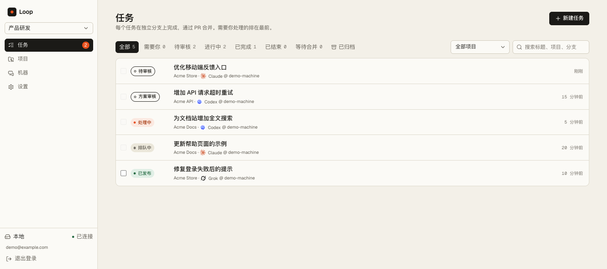
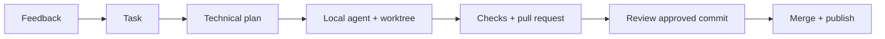

<div align="center">

# Loop

**Turn user feedback into reviewed, shipped code.**

Trigger → Agent → Build → Review → Ship

[](https://github.com/i1mT/loop/actions/workflows/ci.yml)
[](../../LICENSE)

[简体中文](../../README.md) · [Self-hosting](../self-hosting.md) · [Contributing](../../.github/CONTRIBUTING.md)

</div>

Loop is a self-hosted development workspace that connects feedback to the coding agents running on your machines. Receive requests from the web UI, an API, an embedded feedback SDK or Feishu. Each task gets an isolated Git worktree, a session, project checks and a pull request. Review a specific commit before merging and shipping.

**Early-stage software:** the current clients are a Web workspace and a Node.js daemon. Start with a disposable test repository before connecting important projects.



*Workspace preview using synthetic projects and a demo account.*

## Features

- Markdown tasks, attachments, priorities, archival and recovery.
- Spaces that isolate accounts, projects, feedback and tasks.
- Multiple execution machines with leases and independent heartbeats.
- ACP support for Claude Code, Codex, Grok, OpenCode, Pi and DeepSeek Harness.
- Machine-level agent, model and reasoning settings.
- Conversation history, changes, checks, activity and commit-specific review.
- Small-feedback batching into one task, session and PR.
- Project-scoped API keys and an embedded screenshot feedback SDK.
- A Feishu bot per space, status replies and task-specific Wiki design documents.
- Follow-up iterations that retain session context and create a new PR round.

## How it works



Technical plans are enabled by space integration settings. Optional plan review and code review are separate decisions. The daemon handles GitHub operations; the original agent session follows the managed project's publishing instructions after merge.

## Quick start

Requirements: **Node.js 24+, pnpm, Git, authenticated GitHub CLI**, a configured coding agent and your own Neon Postgres database. Production hosting uses Cloudflare Workers and R2.

```bash
git clone https://github.com/i1mT/loop.git
cd loop
corepack enable
pnpm install --frozen-lockfile
cp apps/web/.dev.vars.example apps/web/.dev.vars
```

Fill in your development database URL and independently generated secrets. Generate each value separately:

```bash
node -e "console.log(require('crypto').randomBytes(32).toString('base64'))"
node --env-file=apps/web/.dev.vars --experimental-strip-types scripts/migrate.mjs
node --env-file=apps/web/.dev.vars scripts/create-user.mjs admin@example.com --super
pnpm --filter @loop/web run dev --port 5190
```

In another terminal, set the daemon token to the same value used by the gateway:

```bash
export LOOPD_GATEWAY=http://localhost:5190
export LOOPD_DAEMON_TOKEN='your-generated-daemon-token'
./scripts/start-daemon.sh
```

Open **http://localhost:5190**, sign in, create a space, connect a machine and add a GitHub project. API tokens cannot be used as browser passwords. Production setup and local-forwarding mode are documented in the [self-hosting guide](../self-hosting.md).

## Project instructions

The managed repository's `AGENTS.md` should explain its constraints, test command, optional preview command, publishing procedure, external configuration location and success criteria. Publishing uses the task worktree; ignored local configuration from your main checkout is not automatically copied there.

## Architecture

| Package | Responsibility |
| --- | --- |
| `apps/web` | Web UI, HTTP API, authentication, tasks and integration jobs |
| `apps/daemon` | ACP sessions, worktrees, project checks, GitHub and publishing |
| `packages/core` | Shared state machine, attributes and event contracts |
| `apps/web/sdk` | Embeddable browser feedback collector |

The daemon talks to the gateway over HTTP. It does not connect directly to the database. Task metadata and session records are stored in your gateway's database, while source execution happens on your machines.

## Execution boundaries

Agents run with automatic approval. A Git worktree is **not an operating-system sandbox**: an agent can access files and networks allowed to its execution account. Model requests follow the selected agent/provider configuration and are not necessarily offline.

Keep credentials outside Git. Use separate test and production databases. Report vulnerabilities through the [private reporting process](../../.github/SECURITY.md).

## Development

```bash
pnpm run typecheck
pnpm run test
pnpm run build
```

See [development](../development.md), [architecture](../architecture.md) and [integrations](../integrations.md). The detailed guides currently use Simplified Chinese; documentation translations are welcome.

## License and acknowledgements

[MIT License](../../LICENSE). Third-party notices are preserved [here](../legal/THIRD_PARTY_NOTICES.md).

Built with ACP, vinext, Cloudflare Workers, Neon Postgres, Radix UI, Lucide and LobeHub Icons. Agent CLIs and model providers remain separate products with their own terms and credentials.
